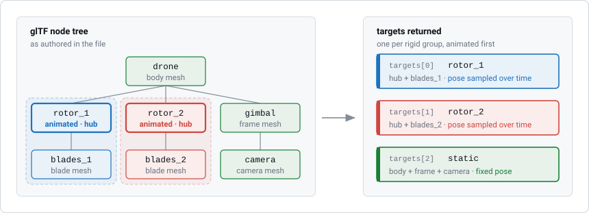
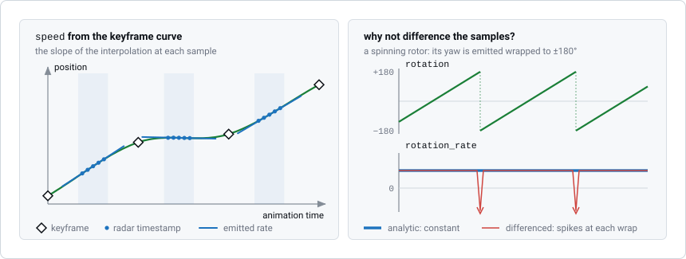
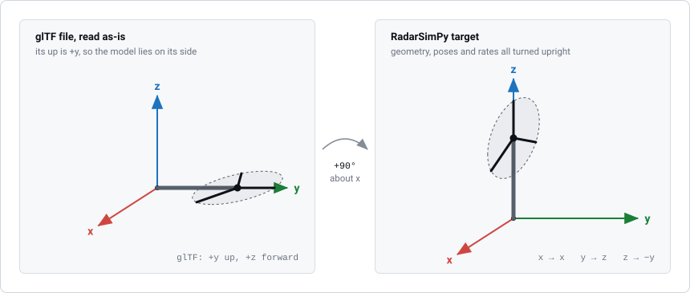
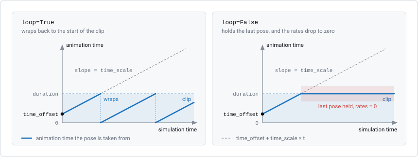

Animated Targets (glTF 2.0 / GLB)
==================================

Normally you describe a target's motion yourself, with ``speed`` and
``rotation_rate`` in its target dictionary. That works for a rigid object
moving at constant velocity and turning at a constant rate. Many 3D models,
however, already contain their own animation: a drone with spinning rotors, a
wind turbine, a car with turning wheels, or an object following a keyframed
path.

:mod:`radarsimpy.animation_kit` reads this animation from a **glTF 2.0 / GLB**
file and converts it into ordinary target dictionaries. The rest of your
simulation stays the same.

Quick Start
-----------

Install the optional glTF parser first:

.. code-block:: bash

    pip install pygltflib

Then load the model:

.. code-block:: python

    import radarsimpy
    from radarsimpy.animation_kit import load_animated_targets
    from radarsimpy.simulator import sim_radar

    radar = radarsimpy.Radar(transmitter=tx, receiver=rx)

    targets = load_animated_targets(
        "turbine.glb",
        radar,
        location=(80, 0, 0),
        permittivity="PEC",
    )

    data = sim_radar(radar, targets)

``load_animated_targets`` returns a normal ``list`` of target dictionaries. You
can inspect or edit them, or combine them with targets you wrote by hand,
before passing them to :func:`radarsimpy.sim_radar`.

How the Model Becomes Targets
-----------------------------

**Each animated node becomes one target.** In glTF, a *node* is an object in
the scene tree, and an animation moves nodes. Every animated node becomes its
own RadarSimPy target. Any mesh under a node is assigned to the closest
animated node above it, so each target moves as one rigid body. Meshes with no
animated node above them are merged into one static target. Pass
``merge_static=False`` to keep them separate.

    A drone with two animated rotor nodes. Each rotor target includes its hub
    and the blades below it. The body, gimbal and camera have no animated node
    above them, so they are merged into one static target. Animated parts come
    first in the returned list.

**Motion is sampled at the radar's timestamps.** The pose of each node is
calculated at every value in ``radar.time_prop["timestamp"]`` and returned as
time-varying ``location`` and ``rotation`` arrays. This is the same format the
simulator accepts for motion you write by hand.

**Velocities are exact, not estimated from differences.** ``speed`` and
``rotation_rate`` are calculated from the derivative of the keyframe
interpolation. The simulator uses these two values (not the change in
position between samples) to compute the velocity at each hit point, so they
are what makes the Doppler correct.

    Left: radar timestamps come in short bursts, one per pulse. At each
    timestamp, the rate is the slope of the keyframe curve, regardless of the
    gap to the next sample. Right: a spinning rotor's ``rotation`` is wrapped
    to ±180°. Taking differences would create a false −360°/Δt spike in
    ``rotation_rate`` at every wrap. The exact rate stays constant.

**Axes are converted.** glTF uses y as the up axis; RadarSimPy uses z (see
:doc:`coordinate_systems`). Geometry, poses and rates are rotated to match. If
your model was already exported with z up, pass ``up_axis="z"``.

    A wind turbine created with y up, shown in RadarSimPy's axes. Without
    conversion, its tower lies along +y. The default ``up_axis="y"`` rotates
    it +90° about x, so the tower points along +z and the glTF forward axis
    (+z) points along −y.

Moving the Whole Model
----------------------

``location``, ``rotation``, ``speed`` and ``rotation_rate`` place and move the
whole model. This motion is added on top of the model's own animation. For
example, a drone flying past with its rotors spinning:

.. code-block:: python

    targets = load_animated_targets(
        "drone.glb",
        radar,
        location=(60, -20, 15),
        speed=(0, 12, 0),
    )

Controlling Playback
--------------------

.. code-block:: python

    targets = load_animated_targets(
        "walk.glb", radar,
        animation="walk_cycle",  # name or index; default is the first clip
        time_offset=0.3,         # animation time at simulation time zero
        time_scale=1.5,          # play the clip 1.5x faster
        loop=True,               # wrap when the simulation outlasts the clip
    )

With ``loop=False``, the model holds its first pose before the clip and its
last pose after it, and its rates are zero outside the clip.

    Simulation time ``t`` becomes animation time
    ``time_offset + time_scale × t`` (dashed line). With ``loop=True``, the
    animation restarts each time it reaches the end of the clip. With
    ``loop=False``, the last pose is held and ``speed`` and ``rotation_rate``
    are zero from then on.

Static Snapshots for RCS and LiDAR
----------------------------------

:func:`radarsimpy.sim_rcs` and :func:`radarsimpy.sim_lidar` do not accept
time-varying motion. Instead, request a single moment with ``at_time``. This
returns targets with ordinary, constant values:

.. code-block:: python

    targets = load_animated_targets("turbine.glb", at_time=0.25)
    rcs = sim_rcs(targets, f=77e9, inc_phi=0, inc_theta=90)

Inspecting the Parts
--------------------

:func:`radarsimpy.animation_kit.load_animated_model` shows how a model is
split into parts, without sampling any motion:

.. code-block:: python

    model = load_animated_model("drone.glb")
    print(model["animations"], model["duration"])
    for part in model["parts"]:
        print(part["name"], part["animated"], len(part["cells"]), "faces")

Animated targets also work with :func:`radarsimpy.mesh_kit.get_target_mesh`
and :func:`radarsimpy.get_scene_state`, so you can plot the moved geometry at
any time.

What Is Supported
-----------------

.. list-table::
   :header-rows: 1
   :widths: 40 60

   * - Feature
     - Status
   * - ``.gltf`` and ``.glb``
     - Supported
   * - Node ``translation`` / ``rotation`` animation
     - Supported
   * - ``STEP``, ``LINEAR`` and ``CUBICSPLINE`` interpolation
     - Supported
   * - Nested node hierarchies
     - Supported
   * - Uniform, constant scale
     - Supported (applied to the geometry when loading)
   * - Skinning (``skins``, ``JOINTS_0`` / ``WEIGHTS_0``)
     - Not supported
   * - Morph targets (``weights`` animation)
     - Not supported
   * - Animated scale
     - Not supported
   * - Non-uniform scale on an animated node
     - Not supported
   * - Non-triangle primitives
     - Not supported

All unsupported features move individual vertices, but the ray tracer can only
move each target as a rigid body. These features raise a
``NotImplementedError`` with an explanation, instead of giving a wrong result
without warning. To simulate a deforming object, such as a walking person,
split it into rigid parts and animate their nodes.

Limitations
-----------

**Memory.** Each animated part needs twelve ``float32`` arrays the size of
``radar.time_prop["timestamp"]``. For 4 channels, 256 pulses and 512 samples,
that is about 25 MB per part, so a model with twenty parts needs about 500 MB.
This is required for time-varying motion, because the arrays must match the
baseband's time grid. To reduce memory, merge parts that do not move
independently.

**Gimbal lock.** Poses are returned as ``[yaw, pitch, roll]``. At a pitch of
exactly ±90°, yaw and roll cannot be told apart, and a warning is shown. Avoid
animations that pass exactly through this angle.

**Free tier mesh limit.** The face-count limit applies to each target
separately, and each animated part is a separate target.

See Also
--------

* :doc:`coordinate_systems` - The Z-up frame and the yaw/pitch/roll convention
* :doc:`ray_tracing_simulation` - How mesh targets are simulated
* :doc:`dependencies` - Optional package requirements
