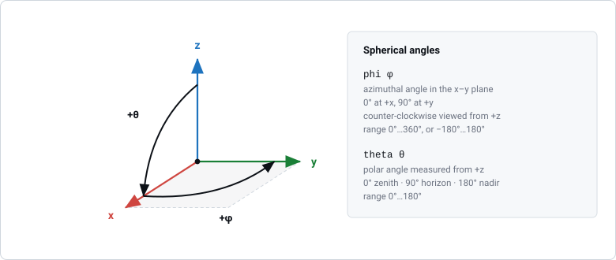
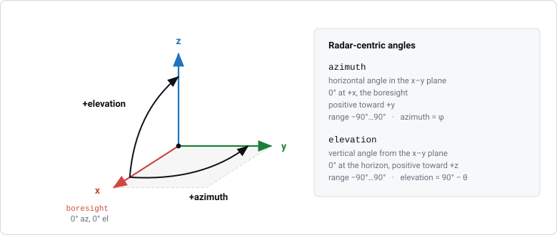
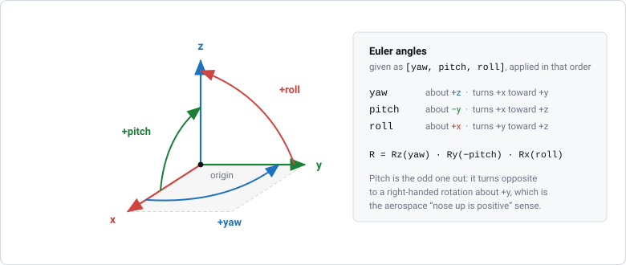

Coordinate Systems
==================

RadarSimPy uses one coordinate frame for everything: radars, targets, antenna
patterns and motion. It is a right-handed Cartesian frame with z pointing up.
Angles are in degrees and distances are in metres.

This page defines the frame, the two ways of describing a direction in it, and
the angles used to rotate objects.

At a Glance
-----------

.. list-table::
   :header-rows: 1
   :widths: 20 12 12 56

   * - Quantity
     - Symbol
     - Unit
     - Meaning
   * - position
     - ``[x, y, z]``
     - m
     - Right-handed, z pointing up
   * - phi
     - :math:`\phi`
     - °
     - Angle in the x–y plane, 0° at +x
   * - theta
     - :math:`\theta`
     - °
     - Angle down from +z, 0° straight up
   * - azimuth
     - —
     - °
     - Same as :math:`\phi`; the name used for radar beams
   * - elevation
     - —
     - °
     - Angle above the x–y plane, :math:`90° - \theta`
   * - orientation
     - ``[yaw, pitch, roll]``
     - °
     - Rotation about z, −y and x respectively

The Global Frame
----------------

The axes have no fixed geographic meaning; you decide what they represent. The
directions are:

- **x** — forward. A radar with zero rotation points along +x.
- **y** — left, when looking along +x.
- **z** — up.

You can describe a direction either as a unit vector or as two spherical angles,
:math:`(\phi, \theta)`:

    :math:`\phi` is measured in the x–y plane from +x. :math:`\theta` is
    measured down from +z. The arrows show the direction in which each angle
    increases.

* **phi** (:math:`\phi`) is the angle in the x–y plane. It is 0° along +x and
  90° along +y, and increases counter-clockwise when viewed from above. Its
  range is 0°–360° (or, equivalently, −180°–180°).
* **theta** (:math:`\theta`) is the angle from +z. It is 0° straight up, 90° in
  the x–y plane and 180° straight down.

To convert between the two forms:

.. math::

   x &= r \sin\theta \cos\phi \\
   y &= r \sin\theta \sin\phi \\
   z &= r \cos\theta

.. math::

   r &= \sqrt{x^2 + y^2 + z^2} \\
   \phi &= \operatorname{atan2}(y, x) \\
   \theta &= \arccos(z / r)

.. code-block:: python

   import numpy as np

   def to_spherical(v):
       x, y, z = v
       r = np.linalg.norm(v)
       return r, np.degrees(np.arctan2(y, x)), np.degrees(np.arccos(z / r))

   to_spherical([1, 1, 1])     # (1.732, 45.0, 54.74)

Azimuth and Elevation
---------------------

For antenna patterns and beams it is easier to measure angles from the radar's
pointing direction (boresight, +x) than from straight up. Azimuth and elevation
do this:

    Boresight is +x, where azimuth and elevation are both zero. Azimuth turns
    in the x–y plane toward +y. Elevation tilts up out of that plane toward +z.

* **azimuth** is the horizontal angle. It is 0° at boresight (+x) and positive
  toward +y, which is to the left when you stand behind the radar. It is the
  same angle as :math:`\phi`.
* **elevation** is the vertical angle. It is 0° at the horizon and positive
  upward (toward +z).

.. math::

   \text{azimuth} &= \phi \\
   \text{elevation} &= 90° - \theta

Both pairs describe the same directions; they only differ in where zero is.

.. note::

   By default, transmit and receive antenna patterns are defined from −90° to
   90° in both azimuth and elevation (``azimuth_angle`` and
   ``elevation_angle``). That is only the default range of the pattern arrays,
   not a limit on angles in general. See :doc:`transmitter` and
   :doc:`receiver` for how to define patterns, and why the absolute gain goes
   in the azimuth pattern.

Orientation
-----------

You rotate an object with three angles, ``[yaw, pitch, roll]``:

    Each arc has the colour of the axis it rotates about. Note that pitch
    rotates about −y, not +y.

.. list-table::
   :header-rows: 1
   :widths: 14 14 36 36

   * - Angle
     - About
     - Positive direction
     - Typical range
   * - ``yaw``
     - +z
     - Turns +x toward +y
     - −180°…180°
   * - ``pitch``
     - −y
     - Turns +x toward +z
     - −90°…90°
   * - ``roll``
     - +x
     - Turns +y toward +z
     - −180°…180°

The combined rotation matrix is

.. math::

   R = R_z(\text{yaw}) \cdot R_y(-\text{pitch}) \cdot R_x(\text{roll})

.. important::

   **Positive pitch means nose up.** Yaw and roll are standard right-handed
   rotations about +z and +x. Pitch is different: a right-handed rotation about
   +y would turn +x toward −z, but positive pitch turns +x toward +z. This is
   the aerospace convention, and it is why the matrix uses
   :math:`R_y(-\text{pitch})`. If you import orientations from a tool that uses
   a strict right-handed pitch, flip the sign of pitch.

Order of rotations
~~~~~~~~~~~~~~~~~~

The rotations are applied in the order **yaw, then pitch, then roll**, each
about the object's own (already rotated) axes:

1. yaw about z,
2. pitch about the new y axis,
3. roll about the new x axis.

In the matrix above, which acts on a column vector, the same sequence reads
right to left.

The order matters because rotations do not commute. Swapping the order gives a
different result:

.. code-block:: python

   import numpy as np
   from radarsimpy.animation_kit import _rsx_euler_to_quat, _quat_rotate

   def rotate(rotation_deg, vec):
       q = _rsx_euler_to_quat(np.radians(rotation_deg))
       return _quat_rotate(q, np.array(vec, dtype=float))

   rotate([90, 0, 90], [0, 1, 0])      # -> [0, 0, 1]

   # roll first, then yaw, about the fixed global axes: same answer
   rotate([90, 0, 0], rotate([0, 0, 90], [0, 1, 0]))    # -> [0, 0, 1]

   # yaw first, then roll: a different direction
   rotate([0, 0, 90], rotate([90, 0, 0], [0, 1, 0]))    # -> [-1, 0, 0]

Pointing a radar
~~~~~~~~~~~~~~~~

Roll rotates about the object's own x axis, which is the boresight, so roll
never changes where the radar points. Yaw and pitch are therefore exactly the
azimuth and elevation of the boresight:

.. code-block:: python

   rotation = [azimuth, elevation, roll]

For example, to point a radar at 30° azimuth and 20° below the horizon, use
``rotation=[30, -20, 0]``. Roll only spins the antenna pattern around the beam.

Origin
~~~~~~

- ``origin`` (m) is the point that the object rotates about.
- A radar's origin is always ``[0, 0, 0]``. Use ``location`` to place the
  radar.
- A target can set its own ``origin``. This lets a mesh rotate about a hinge,
  an axle or its centre of mass, instead of the zero point of the model file.

Notes
-----

- All angles are in degrees and all distances in metres. This includes rates:
  angular rates are in °/s and velocities in m/s.
- The frame is always right-handed. The pitch sign is a convention for the
  pitch angle only.
- glTF models use a y-up frame and are converted to z-up when loaded. See
  :doc:`animated_targets`.

See Also
--------

* :doc:`system_model` — where the radar sits in this frame, and its virtual array
* :doc:`transmitter` — antenna pattern cuts and the gain convention
* :doc:`receiver` — the receive array in the same frame
* :doc:`ray_tracing_simulation` — placing and orienting 3D mesh targets
* :doc:`animated_targets` — frame conversion for glTF assets (Y-up to Z-up)
* :doc:`doppler_convention` — the sign convention for radial velocity
