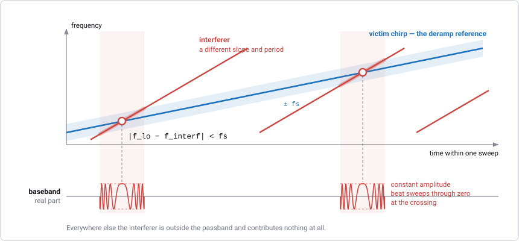

Interference Simulation
=======================

RadarSimPy can simulate *mutual interference*: the signal that another radar
transmits, received directly by the radar you are simulating (the *victim*).
Interference is the main problem when several radars share a frequency band,
as automotive radars do at 77 GHz and 60 GHz.

Interference travels one way, from the interferer to the victim, so its power
falls as :math:`1/R^2`. A target echo travels both ways and falls as
:math:`1/R^4`. As a result, a nearby interferer can be as strong as, or
stronger than, real target echoes, even at low transmit power.

Both radars are described with ordinary ``Transmitter`` objects, so any
waveform works on either side: CW, FMCW, pulsed, phase-coded, stepped
frequency or an arbitrary sweep, with or without modulation. The two radars do
not need to use the same waveform.

What Is Modelled
----------------

* **Any waveform on either side.** The victim and the interferer each have
  their own ``f``, ``t``, ``pulses``, ``prp``, ``f_offset`` hopping, pulse
  modulation (``pulse_amp``, ``pulse_phs``) and fast-time modulation
  (``mod_t``, ``amp``, ``phs``). See :doc:`transmitter`.
* **Both antenna patterns.** The interferer's transmit pattern toward the
  victim, and the victim's receive pattern toward the interferer.
* **Position and motion.** Each radar has its own ``location``, ``speed``,
  ``rotation`` and ``rotation_rate``, evaluated at every sample.
* **Timing.** The interferer only contributes while it is transmitting: not
  before its first frame, not between its pulses, and not while its ``amp``
  is zero.
* **Receiver bandwidth.** Only the part of the interfering signal inside the
  victim's baseband bandwidth reaches the output.
* **A separate output.** Interference is returned in its own array, next to
  ``baseband`` and ``noise``.

Adding an Interferer
--------------------

1. Describe the interferer's waveform with a ``Transmitter``.
2. Give it a ``Receiver``. A ``Radar`` needs one, but it is not used in the
   interference calculation, so any valid settings work.
3. Set its position and orientation with ``Radar(location=..., rotation=...)``.
4. Pass it to ``sim_radar`` as ``interf``.

This example is from the
`interference example <https://radarsimx.com/2023/01/13/interference/>`_. Two
60 GHz radars are 30 m apart and face each other. One chirps down and the other
chirps up across the same 200 MHz, and both change their carrier frequency from
chirp to chirp.

.. code-block:: python

   import numpy as np
   from radarsimpy import Radar, Transmitter, Receiver
   from radarsimpy.simulator import sim_radar

   # the radar under test: down-chirp, 4 chirps hopping in 90 MHz steps
   tx = Transmitter(
       f=[60.6e9, 60.4e9], t=[0, 16e-6], tx_power=25, prp=20e-6, pulses=4,
       f_offset=np.arange(4) * 90e6,
       channels=[{"location": (0, 0, 0), "pulse_phs": np.array([180, 0, 0, 0])}],
   )
   rx = Receiver(fs=40e6, noise_figure=2, rf_gain=20, load_resistor=500,
                 baseband_gain=60, channels=[{"location": (0, 0, 0)}])
   radar = Radar(transmitter=tx, receiver=rx)

   # the interferer: up-chirp, 8 chirps hopping in 70 MHz steps, 30 m away
   int_tx = Transmitter(
       f=[60.4e9, 60.6e9], t=[0, 8e-6], tx_power=15, prp=11e-6, pulses=8,
       f_offset=np.arange(8) * 70e6,
       channels=[{"location": (0, 0.1, 0),
                  "pulse_phs": np.array([0, 0, 180, 0, 0, 0, 0, 0])}],
   )
   int_rx = Receiver(fs=20e6, channels=[{"location": (0, 0.1, 0)}])
   interferer = Radar(transmitter=int_tx, receiver=int_rx,
                      location=(30, 0, 0), rotation=(180, 0, 0))

   targets = [
       {"location": (30, 0, 0), "speed": (0, 0, 0), "rcs": 10},
       {"location": (20, 1, 0), "speed": (-10, 0, 0), "rcs": 10},
   ]

   result = sim_radar(radar, targets, interf=interferer)

``rotation=(180, 0, 0)`` turns the interferer to face along −x, toward the
victim. See :doc:`coordinate_systems` for the angle conventions.

Other Waveforms
---------------

To simulate a different kind of interferer, change only its ``Transmitter``.
The example below uses a CW tone, and the same tone with a phase code of
100 ns per chip, against the FMCW victim from above:

.. code-block:: python

   # a continuous tone in the middle of the victim's band
   cw_tx = Transmitter(f=60.5e9, t=100e-6, tx_power=15,
                       channels=[{"location": (0, 0, 0)}])

   # the same tone, phase-coded: a PMCW neighbour
   chip = 100e-9
   mod_t = np.arange(0, 100e-6, chip)
   code = np.random.default_rng(0).choice([0, 180], mod_t.size)
   pmcw_tx = Transmitter(f=60.5e9, t=100e-6, tx_power=15,
                         channels=[{"location": (0, 0, 0),
                                    "mod_t": mod_t, "phs": code}])

   for neighbour_tx in (cw_tx, pmcw_tx):
       neighbour = Radar(transmitter=neighbour_tx, receiver=int_rx,
                         location=(30, 0, 0), rotation=(180, 0, 0))
       result = sim_radar(radar, targets, interf=neighbour)

Pulsed, stepped-frequency and arbitrary-sweep interferers are set up the same
way, using the examples in :doc:`transmitter`. The victim can use any of these
waveforms too.

Reading the Output
------------------

``result["interference"]`` has the same ``[channels, pulses, samples]`` shape
and channel order as ``baseband`` and ``noise``. The parts are returned
separately, so add them yourself to get the received signal:

.. code-block:: python

   measured = result["baseband"] + result["noise"] + result["interference"]

Having the parts separately makes common analyses simple:

.. code-block:: python

   # signal-to-interference ratio
   sir_db = 20 * np.log10(np.abs(result["baseband"]).max()
                          / np.abs(result["interference"]).max())

   # which pulses were hit at all, [channels, pulses]
   hit = np.abs(result["interference"]).max(axis=-1) > 0

   # which samples were hit — the mask a blanking scheme needs
   mask = np.abs(result["interference"]) > 0

You do not need any targets. ``sim_radar(radar, [], interf=interferer)``
returns an all-zero ``baseband`` and the full ``interference``. This is the
fastest way to study interference on its own.

When Interference Appears
-------------------------

At every sample, the simulator compares two frequencies:

* :math:`f_\text{lo}(t)` — the victim's own frequency at that moment,
* :math:`f_\text{interf}(t)` — the frequency the interferer was transmitting
  when the arriving signal left it.

Both come from each ``Transmitter``'s ``f``, ``t`` and ``f_offset``, so the
same rule applies to every waveform. The interference reaches the output only
when

.. math::

   \lvert f_\text{lo}(t) - f_\text{interf}(t) \rvert < f_s

where :math:`f_s` is the victim's sampling rate ``fs``. For a real baseband
receiver (``bb_type="real"``) the limit is :math:`f_s / 2`
(see :doc:`receiver`).

When this condition holds, the interference oscillates at the difference
frequency :math:`f_\text{lo} - f_\text{interf}` and carries the interferer's
amplitude and phase modulation (its pulse codes, its ``amp`` gating, its
fast-time phase code). The victim's own modulation has no effect: its receiver
records during the whole sample window, regardless of what its transmitter is
doing.

    Two linear chirps with different slopes. Each time the interferer's
    frequency passes through the victim's receive band, a burst appears in the
    baseband. The burst has constant amplitude. Its frequency passes through
    zero when the two chirps cross, so it oscillates fast at the edges and
    slowly in the middle.

What you see depends on how the two frequency curves meet:

.. list-table::
   :header-rows: 1
   :widths: 34 66

   * - Victim and interferer
     - What appears in the baseband
   * - Two chirps, different slopes
     - A short burst each time they cross, as in the figure
   * - Two chirps, same slope
     - Interference during the whole chirp. It looks like a false target
       rather than a short burst.
   * - A chirp and a CW tone
     - One burst per chirp, when the chirp sweeps past the tone
   * - Two CW tones
     - A constant tone at their frequency difference, or nothing if the
       difference is larger than the receive band
   * - A phase-coded interferer
     - Interference carrying the interferer's phase code, which spreads it
       into a noise-like floor
   * - A pulsed interferer
     - Only the parts of the above that fall within its pulses
   * - Arbitrary sweeps
     - A burst wherever the two curves come within the receive band of each
       other

For two linear sweeps, a burst lasts
:math:`2 f_s / \lvert k_\text{victim} - k_\text{interf} \rvert`, where
:math:`k` is the sweep rate (:math:`k = 0` for a CW tone).

From pulse to pulse, the bursts move, appear and disappear, because the two
radars have different pulse periods and frequency hops.

Several Interferers
-------------------

``interf`` takes one ``Radar``. For several interferers, simulate each one
separately and add the results. Interference adds linearly, and ``baseband``
does not depend on the interferer:

.. code-block:: python

   result = sim_radar(radar, targets, interf=interferers[0])
   interference = result["interference"]

   for other in interferers[1:]:
       interference = interference + sim_radar(radar, [], interf=other)["interference"]

   measured = result["baseband"] + result["noise"] + interference

Passing ``[]`` as the targets in the extra runs avoids recomputing the same
``baseband``. Each interferer can use a different waveform.

Controlling the Scenario
------------------------

These parameters control how strong the interference is, how often it occurs
and where it appears:

* **Geometry.** ``location`` sets the distance between the radars.
  ``rotation`` points each antenna toward or away from the other. ``speed``
  and ``rotation_rate`` make the interference change during the frame.
* **Antenna patterns.** ``azimuth_pattern`` and ``elevation_pattern`` on
  either radar scale the interference. Angles outside a pattern's range
  receive nothing (:doc:`transmitter`).
* **Power.** The interferer's ``tx_power`` scales the interference (dB for
  dB). The victim's ``tx_power`` only scales its own echoes.
* **Waveform.** The two frequency curves decide when and for how long they
  overlap. ``f_offset`` hopping and a staggered ``prp`` change which pulses
  are hit. The interferer's modulation is carried into the interference.
* **Receive bandwidth.** The victim's ``fs`` sets the width of the receive
  band (halved for a real baseband), and so how long each overlap lasts.
* **Timing.** Each radar's ``frame_time`` sets when it transmits relative to
  the other.

Limitations
-----------

* Only the **direct path** from the interferer to the victim is modelled.
  Interference that reflects off targets or the environment is not included.
* One interferer per ``sim_radar`` call. Add several as shown above.
* The interferer's ``Receiver`` is not used.

See Also
--------

* `Interference example <https://radarsimx.com/2023/01/13/interference/>`_ —
  the FMCW configuration above as a notebook, with time-frequency and baseband
  plots
* :doc:`transmitter` — configuring CW, FMCW, pulsed, phase-coded and arbitrary
  waveforms
* :doc:`system_model` — why the output components come back separately
* :doc:`receiver` — ``fs`` and ``bb_type``, which set the passband
* :doc:`coordinate_systems` — placing and orienting each radar
* :doc:`noise` — the other additive impairment
* :doc:`../api/sim` — the ``sim_radar`` reference
