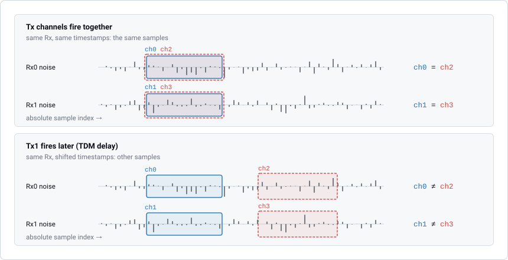
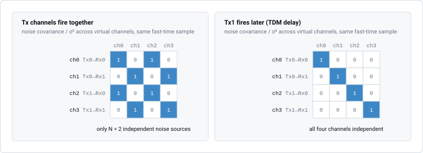
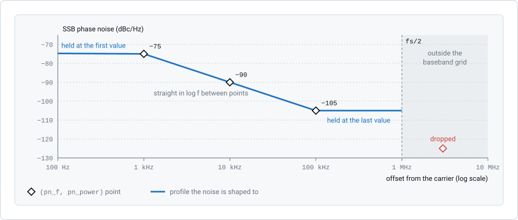
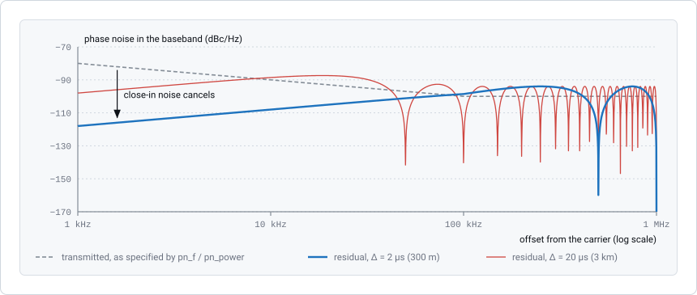

Noise Simulation
================

RadarSimPy simulates two kinds of noise:

* **receiver thermal noise**, added in the receiver front end,
* **transmitter phase noise**, caused by an imperfect oscillator.

This page explains how each is generated and what that means for your signal
processing.

Receiver Thermal Noise
----------------------

``sim_radar`` returns thermal noise in ``result["noise"]``, separate from the
target signal in ``result["baseband"]``. Its level is set by the receiver
settings (see :doc:`receiver`).

Noise Properties
~~~~~~~~~~~~~~~~

The thermal noise is:

* **Gaussian and white**, with zero mean. Its standard deviation comes from
  the noise figure, gains, bandwidth and load resistance.
* **Independent between frames.** Each frame gets new noise.
* **Independent between physical receive channels.**
* **Reproducible.** With the same random seed, you get exactly the same noise.

Complex vs. Real Baseband
^^^^^^^^^^^^^^^^^^^^^^^^^

* **Complex baseband** (``bb_type="complex"``): the real and imaginary parts
  are independent Gaussian noise, each with standard deviation
  :math:`\sigma / \sqrt{2}`. The total RMS amplitude is :math:`\sigma`.
* **Real baseband** (``bb_type="real"``): the noise is real, with standard
  deviation :math:`\sigma`.

Same Timestamp, Same Rx → Same Noise
~~~~~~~~~~~~~~~~~~~~~~~~~~~~~~~~~~~~

.. important::

   Two output samples get **exactly the same** noise value if they come from
   the **same physical Rx channel** at the **same timestamp**. This is true no
   matter how many virtual channels share that receiver.

The noise value of each sample depends only on three things:

1. **Frame index** — which frame the sample is in.
2. **Physical Rx channel** — ``rx_ch = ch_idx % rx_size``.
3. **Absolute sample index** — the sample's position on the time grid (its
   timestamp relative to the earliest one, divided into steps of
   :math:`1/f_s`).

Samples with the same ``(frame_idx, rx_ch, absolute_sample_index)`` always get
the same noise value.

Noise in MIMO Configurations
~~~~~~~~~~~~~~~~~~~~~~~~~~~~

With :math:`M` Tx and :math:`N` Rx channels, each frame has
:math:`M \times N` virtual channels, in this order:

.. code-block:: text

   ch[0]         = Tx0 → Rx0
   ch[1]         = Tx0 → Rx1
   ...
   ch[N-1]       = Tx0 → Rx(N-1)
   ch[N]         = Tx1 → Rx0
   ch[N+1]       = Tx1 → Rx1
   ...
   ch[M*N - 1]   = Tx(M-1) → Rx(N-1)

The physical Rx channel of virtual channel ``ch_idx`` is:

.. math::

   \text{rx\_ch} = \text{ch\_idx} \mod N

Which channels share noise
^^^^^^^^^^^^^^^^^^^^^^^^^^

Virtual channels that use the **same physical Rx** and have the **same
transmit timing** (identical timestamps) contain identical noise. For example,
with 2 Tx and 2 Rx:

.. code-block:: text

   ch[0] = Tx0 → Rx0    ─┐
   ch[2] = Tx1 → Rx0    ─┘  Same Rx0, same timing → identical noise

   ch[1] = Tx0 → Rx1    ─┐
   ch[3] = Tx1 → Rx1    ─┘  Same Rx1, same timing → identical noise

This matches real hardware: thermal noise is generated in the receiver, so all
signals passing through the same receiver at the same time see the same noise.

.. note::

   If the Tx channels transmit at different times (for example, TDM-MIMO with
   a per-channel delay), two virtual channels on the same Rx sample the noise
   at different times. Their noise is then **different**.

    Each physical Rx has one noise sequence per frame, on the absolute sample
    grid. Each virtual channel reads the part of its Rx sequence that matches
    its timestamps. Top: both Tx channels transmit at the same time, so
    ``ch0`` and ``ch2`` read the same Rx0 samples. Bottom: a delay on Tx1
    moves ``ch2`` and ``ch3`` to later samples, which are independent.

What this means for MIMO processing
^^^^^^^^^^^^^^^^^^^^^^^^^^^^^^^^^^^

When you do MIMO beamforming or angle estimation:

* **The noise is correlated.** Virtual channels that share an Rx have fully
  correlated noise. The noise covariance matrix across virtual channels is
  **not** a scaled identity matrix; it has a block structure that follows the
  Rx grouping.
* **There are only N independent noise sources**, one per physical Rx. Each is
  repeated in the :math:`M` Tx paths that share its timing.
* **Averaging does not reduce this noise.** Each virtual channel has the same
  noise power as its physical Rx. Averaging virtual channels that share an Rx
  does not lower the noise, because their noise samples are identical.

    Noise covariance for the 2 Tx × 2 Rx example, at one fast-time sample.
    When both Tx channels transmit together, ``ch0``/``ch2`` and
    ``ch1``/``ch3`` are fully correlated, which gives the block structure.
    With a Tx delay they use different sample indices, and the matrix becomes
    the identity.

Example
^^^^^^^

.. code-block:: python

   import numpy as np
   from radarsimpy import Radar, Transmitter, Receiver
   from radarsimpy.simulator import sim_radar

   # 2 Tx, 2 Rx MIMO radar
   tx = Transmitter(
       f=[24.075e9, 24.175e9],
       t=80e-6,
       tx_power=10,
       prp=100e-6,
       pulses=4,
       channels=[{"location": (0, 0, 0)}, {"location": (0, 0, 0)}],
   )
   rx = Receiver(
       fs=2e6,
       noise_figure=10,
       rf_gain=20,
       load_resistor=500,
       baseband_gain=30,
       bb_type="complex",
       channels=[{"location": (0, 0, 0)}, {"location": (0, 0, 0)}],
   )
   radar = Radar(transmitter=tx, receiver=rx)

   result = sim_radar(radar, targets=[{"location": (200, 0, 0), "rcs": 10}])
   noise = result["noise"]

   # Virtual channels: ch0=Tx0-Rx0, ch1=Tx0-Rx1, ch2=Tx1-Rx0, ch3=Tx1-Rx1
   # ch0 and ch2 share Rx0 with same timing → identical noise
   assert np.array_equal(noise[0], noise[2])

   # ch1 and ch3 share Rx1 with same timing → identical noise
   assert np.array_equal(noise[1], noise[3])

   # Different Rx channels have independent noise
   assert not np.array_equal(noise[0], noise[1])

Multiple Frames
~~~~~~~~~~~~~~~

Each frame gets independent noise. Virtual channels in different frames always
have different noise, even on the same physical Rx:

.. code-block:: python

   # With 2 frames, 1 Tx, 1 Rx:
   # ch[0] = Frame 0, ch[1] = Frame 1
   assert not np.array_equal(noise[0], noise[1])

So processing across frames sees independent noise in each frame.

Transmitter Phase Noise
-----------------------

Phase noise is random jitter in the phase of the transmitter's oscillator.
You set it on the ``Transmitter`` with ``pn_f`` and ``pn_power``.

Model
~~~~~

Write the oscillator output as

.. math::

   V(t) = V_0 \cos\bigl(\omega_0 t + \phi(t)\bigr)

where :math:`\phi(t)` is the phase noise. Phase noise is small, so
:math:`e^{jx} \approx 1 + jx` applies and

.. math::

   V(t) \approx V_0 \bigl[\cos(\omega_0 t) - \sin(\omega_0 t)\,\phi(t)\bigr]

This is the same as multiplying the complex baseband signal by
:math:`e^{-j\phi(t)}`.

Parameters
~~~~~~~~~~

Phase noise is given as a single-sideband (SSB) power spectral density:

* ``pn_f`` — frequency offsets from the carrier (Hz). A 1-D array of
  non-negative values.
* ``pn_power`` — the SSB phase noise at each offset (dBc/Hz). A 1-D array
  with the same length as ``pn_f``.

The simulator turns these points into a spectrum on the baseband frequency
grid, from 0 to :math:`f_s/2`:

* Between the given points, the level is interpolated linearly against
  log-frequency.
* Below the first ``pn_f``, the level stays at the first ``pn_power``. The DC
  bin itself is removed.
* Above the last ``pn_f``, the level stays at the last ``pn_power`` up to
  :math:`f_s/2`.
* Points above :math:`f_s/2` are ignored.

    ``pn_f = [1e3, 1e4, 1e5, 3e6]``, ``pn_power = [-75, -90, -105, -125]``
    with ``fs = 2e6``. The three points below :math:`f_s/2` are joined by
    straight lines in log-frequency and held constant at both ends. The 3 MHz
    point is above :math:`f_s/2`, so it is ignored.

Properties
~~~~~~~~~~

**All Tx channels share one oscillator.**
   Phase noise is modelled for the whole transmitter, not per channel. One
   phase noise sequence is generated per frame and applied to every Tx
   channel.

**Independent between frames.**
   Each frame gets a new phase noise sequence. With a ``seed``, frame ``i``
   uses :math:`\text{seed} + i`, so the result is reproducible and the frames
   are still uncorrelated.

**Reproducible.**
   The same ``seed`` on ``Radar`` always gives the same phase noise.

Effect on the Received Signal
~~~~~~~~~~~~~~~~~~~~~~~~~~~~~

Phase noise is part of the transmitted signal, so it appears in every echo.
How much of it remains in the baseband depends on the round-trip delay
:math:`\tau` of the target:

.. math::

   s_{\mathrm{IF}}(t) \propto e^{\,j[\phi(t) - \phi(t-\tau)]}

* **Nearby targets: phase noise cancels.** The receiver mixes the echo with
  the same oscillator, so :math:`\phi(t)` and the delayed :math:`\phi(t-\tau)`
  are correlated. For short delays (:math:`\tau \ll 1/f_{\mathrm{3dB}}`, where
  :math:`f_{\mathrm{3dB}}` is the corner frequency of the phase noise
  spectrum) the two terms almost cancel. This is called the *range
  correlation effect*.
* **Distant targets: phase noise grows.** As :math:`\tau` increases, the two
  terms are less correlated. More phase noise remains, which raises the noise
  floor and lowers the SNR of distant targets.

    The remaining phase noise equals the transmitted profile multiplied by
    :math:`4\sin^2(\pi f \Delta)`. :math:`\Delta` is the delay between the
    echo and the mixer reference: the round trip :math:`\tau`, or :math:`\tau`
    minus ``gate_delay`` when a range gate is set. The profile is the one from
    the example below. At 1 kHz offset, the noise is reduced by about 40 dB at
    300 m but only about 20 dB at 3 km. At larger offsets the cancellation
    stops, and the response becomes a series of nulls spaced :math:`1/\Delta`
    apart.

* **Doppler spreading.** Fast phase changes spread a target's energy into
  neighbouring Doppler bins, which raises the sidelobes in the Doppler
  dimension.
* **No differences between Tx channels.** All Tx channels share the same
  phase noise, so it is identical in every virtual channel. The cancellation
  for nearby targets applies equally to all virtual channels, and phase noise
  causes no channel-to-channel errors.

Rules
~~~~~

* ``pn_f`` and ``pn_power`` must have the same length.
* All values in ``pn_f`` must be non-negative.
* Set both arrays or neither; setting only one raises an error.
* Frequency offsets above :math:`f_s/2` are ignored.

Example
~~~~~~~

.. code-block:: python

   import numpy as np
   from radarsimpy import Radar, Transmitter, Receiver

   # Define a typical -80 dBc/Hz @ 1 kHz, -100 dBc/Hz @ 100 kHz PSD profile
   tx = Transmitter(
       f=24e9,
       t=80e-6,
       tx_power=10,
       prp=100e-6,
       pulses=1,
       pn_f=np.array([1e3, 1e5]),
       pn_power=np.array([-80, -100]),
       channels=[{"location": (0, 0, 0)}],
   )
   rx = Receiver(
       fs=2e6,
       noise_figure=10,
       rf_gain=20,
       load_resistor=500,
       baseband_gain=30,
       channels=[{"location": (0, 0, 0)}],
   )
   radar = Radar(transmitter=tx, receiver=rx, seed=0)

See Also
--------

* :doc:`stretch_processing` - Range correlation when a range gate is configured
* :doc:`doppler_convention` - Doppler sign convention for the baseband signal
* :doc:`../api/radar` - ``Radar``, ``Transmitter`` and ``Receiver`` reference
