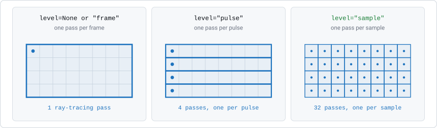
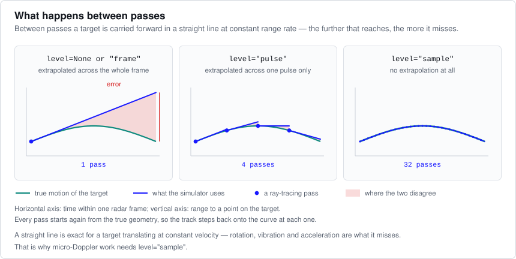
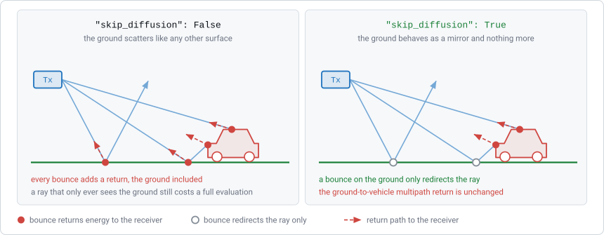
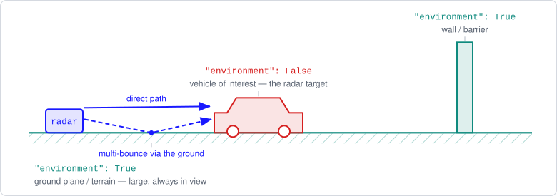
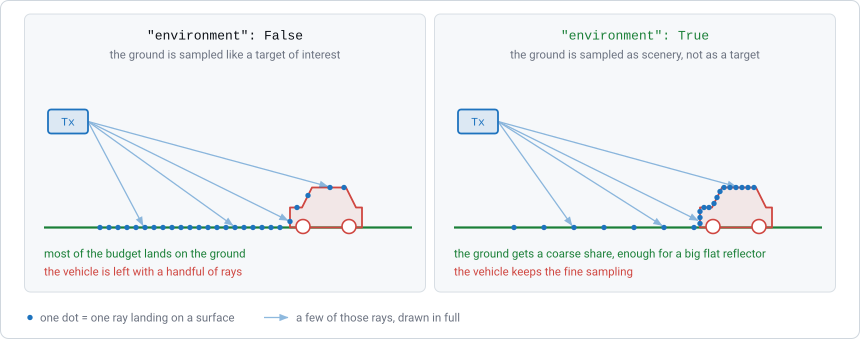
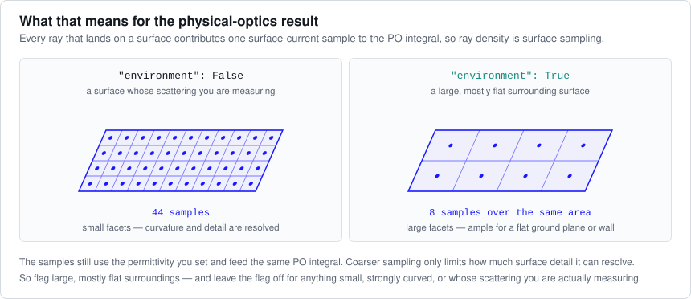
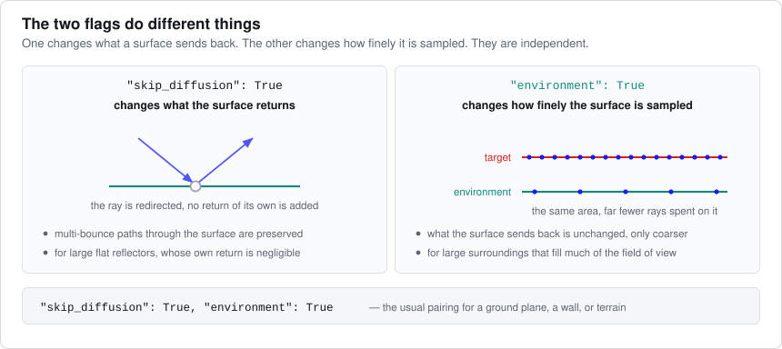

Ray-Tracing Simulation
======================

For 3D mesh targets, ``sim_radar`` uses ray tracing combined with Physical
Optics (PO). It launches rays from the radar, follows them as they bounce
between surfaces, and uses the points where rays hit surfaces to compute the
scattered signal.

This page covers:

* the ``sim_radar`` parameters that control the mesh simulation,
* the target flags that change how individual objects are handled.

None of these settings affect point targets.

``sim_radar`` Parameters
------------------------

``density``
~~~~~~~~~~~

:Type: ``float``
:Default: ``1.0``

The number of rays per wavelength. It sets how many rays are launched toward
each part of the scene that contains an object.

- **Higher values** launch more rays. The target surface is sampled more
  finely and the PO result is more accurate, but the simulation takes longer
  and uses more CPU/GPU memory.
- **Lower values** launch fewer rays and run faster, but may miss small
  features and give less accurate scattering.

``1.0`` is a starting point, not a guarantee of accuracy, especially for
curved targets. To check, increase ``density`` until the result stops
changing. You can use a value below ``1.0`` for faster runs when fine detail
is not needed, or when the mesh faces are large compared with the wavelength.

.. tip::

   You can set ``density`` for an individual target in its dictionary. A
   target ``density`` of ``0.0`` (the default) means it uses the global value
   from ``sim_radar``.

``level``
~~~~~~~~~

:Type: ``str`` or ``None``
:Default: ``None``

How often the scene is ray-traced during a frame:

- ``None`` or ``"frame"`` — once per frame
- ``"pulse"`` — once per pulse
- ``"sample"`` — once per ADC sample

Number of passes
^^^^^^^^^^^^^^^^

A frame is a grid of pulses and samples. The level decides how that grid is
divided into ray-tracing passes:

    Each grid is one frame of one transmit channel: rows are pulses, columns
    are ADC samples. A blue region is what one pass covers.

For a frame with ``P`` pulses of ``S`` samples, each transmit channel needs 1
pass at ``"frame"``, ``P`` passes at ``"pulse"``, and ``P × S`` passes at
``"sample"``. For 128 pulses of 256 samples, that is 1, 128 or 32768 passes.
The run time grows roughly in proportion.

Motion between passes
^^^^^^^^^^^^^^^^^^^^^

Between passes, each target is moved forward along a straight line at its
current **range rate** (the rate at which its range changes). This is exact
for a target moving at constant velocity. For any other motion, the error
grows the longer a pass has to cover:

    Horizontal axis: time within one frame. Vertical axis: range to a point on
    the target. Teal is the true motion, blue is the straight-line
    approximation, red is the error. Each pass starts again from the true
    position, so the blue line returns to the curve at every pass.

Rotation, vibration, acceleration and curved paths are not straight lines. The
level you need depends on how much the scene changes *within one frame*, not
on how fast targets move.

Choosing a level
^^^^^^^^^^^^^^^^

- ``None`` or ``"frame"`` — static scenes, and motion that is nearly straight
  over one frame. This covers most cases: when the pulse rate is high compared
  with how fast the motion changes, a frame only covers a small part of the
  motion. This is the fastest option; start here.
- ``"pulse"`` — motion that curves noticeably during a frame but not within
  one pulse, for example in long frames or fast-changing motion.
- ``"sample"`` — rotating, vibrating or accelerating targets. Needed for
  micro-Doppler studies, because the micro-Doppler signal changes *within* a
  pulse, and the lower levels average this out.

.. note::

   Because run time follows the number of passes, ``"sample"`` can be many
   orders of magnitude slower than ``"frame"``. For micro-Doppler studies,
   reduce the number of pulses to the ones you actually need.

``ray_filter``
~~~~~~~~~~~~~~

:Type: ``list`` or ``None``
:Default: ``None``

Keeps only paths with a certain **number of reflections** (bounces). Only
paths whose bounce count is between ``ray_filter[0]`` and ``ray_filter[1]``
(both inclusive) are included in the baseband.

- ``ray_filter[0]`` — minimum number of reflections.
- ``ray_filter[1]`` — maximum number of reflections.

With ``None``, all paths are included, up to the maximum number of reflections
the simulator supports.

Use it to study one scattering mechanism at a time. For example:

- ``ray_filter=[1, 1]`` — single-bounce (direct) reflections only.
- ``ray_filter=[2, 3]`` — double- and triple-bounce reflections only.

The count covers the whole path. With ``back_propagating`` enabled, a path can
also bounce on its way back to the radar, and those bounces count too: a path
that reaches a target in three bounces and returns with one more counts as
four.

``ray_filter[1]`` also limits how many bounces are traced, because deeper
bounces could not be included anyway. A ray stopped by this limit is treated
as if it were still travelling, so it gets no extra return paths from
``back_propagating`` (see below).

``back_propagating``
~~~~~~~~~~~~~~~~~~~~

:Type: ``bool``
:Default: ``False``

Adds return paths that **reflect off surfaces on the way back** to the radar.

Normally, each point where a ray hits a surface sends energy straight back to
the receiver. This misses echoes that leave a target, bounce off another
surface, and only then reach the radar. Inside a tunnel, for example, much of
the energy reaches the radar via the walls, ceiling and floor.

With this option enabled, a ray that leaves the scene also adds return paths
that bounce back over the same surfaces it hit on the way in. Each such path is
checked: the reflection must land on the surface (not past its edge), and
nothing may block it. These paths are only added for rays that actually left
the scene, not for rays stopped by the ``ray_filter`` bounce limit, because
such a ray might have continued in reality.

.. note::

   This option adds scattering calculations, which take most of the time in a
   mesh simulation. It has no effect when rays do not bounce: a single convex
   target gives exactly the same baseband with or without it.

Target Flags
------------

These flags go in the target dictionary of a 3D mesh target.

``skip_diffusion``
~~~~~~~~~~~~~~~~~~

:Type: ``bool``
:Default: ``False``

Makes a surface a **pure reflector**. Rays still bounce off it, but the
surface itself sends no echo back to the radar.

Use it for **large flat reflectors**, such as ground planes, building walls
or tunnel linings. Such surfaces reflect mostly away from the radar, so their
own echo is negligible compared with the targets.

Effect on the signal
^^^^^^^^^^^^^^^^^^^^

A ray only sends energy back to the radar after it has hit a surface that is
**not** skipped. Bounces on skipped surfaces before that only change the ray's
direction:

    A filled marker is a bounce that sends energy back to the radar. A hollow
    marker only redirects the ray.

So a ray that goes radar → ground → out of the scene adds nothing. A ray that
goes radar → ground → vehicle → radar is fully included, along with any later
bounces. Multipath through the ground is kept; only the ground's own direct
echo is removed.

Effect on run time
^^^^^^^^^^^^^^^^^^

In a scene with a ground plane, many rays hit only the ground. With
``skip_diffusion``:

* directions that only contain skipped surfaces get no rays at all, and
* bounces on skipped surfaces need no scattering calculation.

Scattering calculations take most of the time in a mesh simulation, so this
is usually the largest speed-up available for a scene with a ground plane.

``environment``
~~~~~~~~~~~~~~~

:Type: ``bool``
:Default: ``False``

Marks an object as **surroundings** rather than something you are measuring.
Ground planes, terrain, walls and tunnel linings are surroundings; the
vehicle, pedestrian or corner reflector you are studying is not.

    The surroundings have the flag; the vehicle being studied does not. Both
    still scatter, and the ground-bounce path is simulated either way.

The flag does **not** change the physics. An environment object still
reflects according to its permittivity, still sends its own echo, and still
takes part in multi-bounce paths such as radar → ground → vehicle → radar. The
flag only changes **how many rays it gets**.

Effect on ray density
^^^^^^^^^^^^^^^^^^^^^

The simulator spreads its rays across the objects it can see. Surroundings
are usually the largest objects in the scene and fill most of the field of
view, so without the flag they take most of the rays, leaving fewer for the
targets you care about. ``environment=True`` moves some of those rays to the
targets:

    Each dot is one ray hitting a surface. Only four rays are drawn in full,
    to keep the picture readable.

The saving is real but small. Rays that hit only the environment surface are
still launched and still calculated. If you want to remove those rays, use
``skip_diffusion``, which saves much more.

Effect on accuracy
^^^^^^^^^^^^^^^^^^

Each ray that hits a surface provides one sample of the surface current in
the PO calculation, so fewer rays means coarser sampling of the surface:

    The same surface sampled finely and coarsely. Each dot is one ray hit,
    and one surface-current sample in the PO calculation.

A large flat surface scatters almost the same way whether it is sampled finely
or coarsely, so the flag is safe there. A small, curved or detailed surface
does not, so it should keep the full density.

.. _choosing-between-the-two-flags:

Choosing between the two flags
~~~~~~~~~~~~~~~~~~~~~~~~~~~~~~

Both flags are meant for the same kind of objects, but they do different
things:

    Left: the bounce is hollow because the surface sends no echo of its own.
    Right: the same surface sampled densely as a target and sparsely as
    environment.

- ``skip_diffusion`` controls **whether the surface sends its own echo**.
- ``environment`` controls **how finely the surface is sampled**.

.. important::

   ``skip_diffusion=True`` already includes what ``environment`` does to
   sampling. Setting both on the same surface gains nothing and can cost extra
   rays. Use one or the other.

Which to use:

.. list-table::
   :header-rows: 1
   :widths: 50 50

   * - Object
     - Flag
   * - Large flat reflector whose own echo does not matter (ground plane,
       wall, tunnel lining)
     - ``skip_diffusion=True``
   * - Large surrounding surface whose own echo you **do** want (a broad
       embankment, a terrain mesh)
     - ``environment=True``
   * - A target you are measuring, or any small, curved or detailed object
     - Neither

For example:

.. code-block:: python

   ground = {
       "model": "./models/ground.stl",
       "location": (0, 0, 0),
       "skip_diffusion": True,
   }

   terrain = {
       "model": "./models/terrain.stl",
       "location": (0, 0, 0),
       "environment": True,
   }

See Also
--------

* :doc:`animated_targets` - Driving mesh targets from keyframed glTF motion
* :doc:`coordinate_systems` - Placing and orienting targets in the scene
* :doc:`examples` - Ray-tracing and RCS examples
