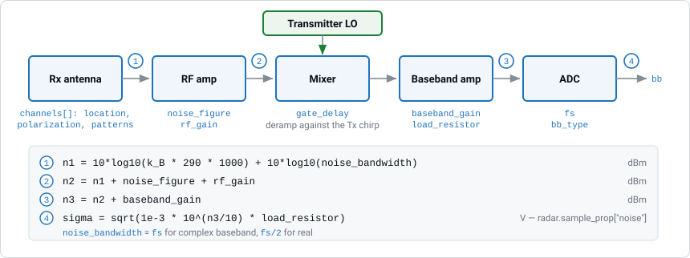

Receiver and Baseband
=====================

:class:`radarsimpy.Receiver` describes everything from the receive antenna to
the analog-to-digital converter (ADC):

* the receive antennas (positions and patterns),
* the gains and the noise they add,
* when the receiver records (the receive window),
* how the baseband is sampled.

The receiver mixes the echo with the transmitter's own oscillator signal (see
:doc:`system_model`), so there are no receiver frequencies to set. You only
configure the sampling rate, the gains and the range gate.

The Signal Chain
----------------

    Each block is labelled with the parameters that configure it. The table
    underneath follows the thermal noise from the antenna to the ADC. The
    result is the standard deviation of the noise added to each baseband
    sample.

Every block has a default value. A receiver created with only ``fs`` uses
``noise_figure=10``, ``rf_gain=0``, ``baseband_gain=0`` and
``load_resistor=500``, which still gives a well-defined noise level.

Sampling
--------

``fs`` is the baseband sampling rate. It sets how many samples are taken in
each pulse:

.. math::

   \text{samples\_per\_pulse} = \text{pulse\_length} \times f_s

The receive window is exactly one ``pulse_length`` long. It opens
``gate_delay`` after each pulse starts. The receiver does not record during
the idle time between pulses.

.. note::

   Choose ``fs`` so that ``pulse_length * fs`` is an exact integer. The
   constructor rounds values that are within floating-point error of an
   integer, but an exact product guarantees that Python and the C++ engine
   agree on the sample count.

Complex vs. real baseband
~~~~~~~~~~~~~~~~~~~~~~~~~

``bb_type`` selects a complex (I/Q) or a real baseband:

.. list-table::
   :header-rows: 1
   :widths: 30 35 35

   * -
     - ``bb_type="complex"`` (default)
     - ``bb_type="real"``
   * - Output data type
     - Complex
     - Real
   * - ``noise_bandwidth``
     - ``fs``
     - ``fs / 2``
   * - Sign of the beat frequency
     - Kept — positive and negative beat frequencies can be told apart
     - Lost — a target a given distance beyond the gate looks the same as one
       the same distance before it

Because a real baseband has half the noise bandwidth, its noise amplitude is
:math:`\sqrt{2}` times lower than that of an otherwise identical complex
receiver.

Range span for FMCW
~~~~~~~~~~~~~~~~~~~

In an FMCW radar with a linear chirp, range is converted to beat frequency by
the chirp slope. The sampling rate therefore limits the range span you can
see:

.. math::

   \text{span} = \frac{B_\text{usable} \cdot c}{2 \left| k \right|}

where :math:`k` is the chirp slope and :math:`B_\text{usable}` is ``fs`` for
a complex baseband or ``fs/2`` for a real one. The radar reports both:

.. code-block:: python

   >>> radar.chirp_slope
   1e+14
   >>> radar.unambiguous_range_span
   29.98
   >>> radar.unambiguous_range_window
   (0.0, 29.98)

For example, a 4 GHz sweep in 40 µs has a slope of 100 MHz/µs, so a 20 MHz
complex baseband covers only 30 m. To cover more range, use a faster ADC, a
slower sweep, or a range gate.

.. note::

   These properties only apply to a linear FM chirp. They return ``None`` for
   CW, pulsed and arbitrary waveforms, where range does not map to beat
   frequency.

The Noise Budget
----------------

The standard deviation of the thermal noise is calculated once, when the
``Radar`` is created, and stored in ``radar.sample_prop["noise"]``. The steps
match the figure above:

.. code-block:: text

   n1    = 10*log10(k_B * 290 * 1000) + 10*log10(noise_bandwidth)   [dBm]
   n2    = n1 + noise_figure + rf_gain                              [dBm]
   n3    = n2 + baseband_gain                                       [dBm]
   sigma = sqrt(1e-3 * 10**(n3/10) * load_resistor)                 [V]

The reference temperature is always 290 K. A worked example:

.. list-table::
   :header-rows: 1
   :widths: 46 27 27

   * - Step
     - Expression
     - Value
   * - Thermal noise floor, ``fs = 20 MHz``, complex
     - :math:`-174 + 73.0`
     - −101.0 dBm
   * - After the RF amplifier, ``noise_figure=8``, ``rf_gain=20``
     - :math:`-101.0 + 28`
     - −73.0 dBm
   * - After the baseband amplifier, ``baseband_gain=30``
     - :math:`-73.0 + 30`
     - −43.0 dBm
   * - As a voltage across ``load_resistor=500``
     - :math:`\sqrt{10^{-3} \cdot 10^{-4.3} \cdot 500}`
     - 5.03 mV

.. code-block:: python

   from radarsimpy import Radar, Transmitter, Receiver

   tx = Transmitter(f=[77e9, 81e9], t=[0, 40e-6], pulses=128, prp=50e-6)
   rx = Receiver(
       fs=20e6,
       noise_figure=8,
       rf_gain=20,
       baseband_gain=30,
       load_resistor=500,
   )
   radar = Radar(transmitter=tx, receiver=rx)

   radar.sample_prop["noise"]   # 0.005026...

Two common surprises:

* **Gain does not improve SNR.** ``rf_gain`` and ``baseband_gain`` amplify the
  signal and the noise by the same amount. They change the absolute level of
  the baseband, but not the signal-to-noise ratio (SNR). Only
  ``noise_figure`` and ``noise_bandwidth`` change the SNR.
* **Noise is not added for you.** ``sim_radar`` returns the noise-free signal
  in ``result["baseband"]`` and the noise in ``result["noise"]``. Add them to
  get a noisy measurement.

:doc:`noise` describes the noise statistics, how noise is shared between MIMO
virtual channels, and the phase-noise model.

The Range Gate
--------------

``gate_delay`` delays both the receive window and the mixer reference by the
same amount. A target at range ``c * gate_delay / 2`` then produces a beat
frequency of zero, and a target ``dR`` away from that range produces a beat
frequency of ``2 * k * dR / c``:

.. code-block:: python

   gate_range = 111.12e3                        # m
   rx = Receiver(fs=40e6, gate_delay=2 * gate_range / 299792458)

   rx.gate_range     # 111120.0

The default is ``0`` (no gate). That works at short range. At long range it
does not: the beat frequency ``k * tau`` grows with the round-trip delay
``tau`` and exceeds the Nyquist frequency long before the ranges of a real
long-range radar. :doc:`stretch_processing` explains the calculation and the
limitations, including how ``gate_delay`` interacts with per-pulse
``f_offset`` and phase codes.

Receive Channels
----------------

``channels`` is a list of dictionaries, one per receive antenna. Only
``location`` is required.

.. list-table::
   :header-rows: 1
   :widths: 30 16 54

   * - Key
     - Default
     - Meaning
   * - ``location``
     - —
     - ``[x, y, z]`` in metres, relative to the radar origin.
   * - ``polarization``
     - ``[0, 0, 1]``
     - Antenna polarization vector. Vertical ``[0, 0, 1]``, horizontal
       ``[0, 1, 0]``, right-hand circular ``[0, 1, 1j]``, left-hand circular
       ``[0, 1, -1j]``.
   * - ``azimuth_angle`` / ``azimuth_pattern``
     - ``[-90, 90]`` / ``[0, 0]``
     - Angles (degrees) and gains (dB) of the azimuth pattern. Same length.
   * - ``elevation_angle`` / ``elevation_pattern``
     - ``[-90, 90]`` / ``[0, 0]``
     - The same, for elevation.

Patterns work the same way as for the transmitter. The **peak of the azimuth
pattern** is used as the channel's antenna gain, and the azimuth pattern is
normalized to that peak. The **elevation pattern** is normalized to its own
peak, so only its shape matters. Put the absolute gain in the azimuth pattern.

Example: a uniform linear array of 8 antennas along the y axis, spaced half a
wavelength apart.

.. code-block:: python

   import numpy as np
   from radarsimpy import Receiver

   wavelength = 3e8 / 79e9
   rx = Receiver(
       fs=20e6,
       noise_figure=8,
       rf_gain=20,
       baseband_gain=30,
       channels=[
           {"location": (0, i * wavelength / 2, 0)} for i in range(8)
       ],
   )

The receive and transmit locations together form the virtual array. See
:doc:`system_model` for the channel order.

Reading the Configuration Back
------------------------------

.. code-block:: python

   rx.sampling_rate        # fs
   rx.noise_bandwidth      # fs or fs/2, per bb_type
   rx.gate_delay           # s
   rx.gate_range           # gate_delay * c / 2, m
   rx.num_channels
   rx.channel_locations    # [N, 3]
   rx.get_channel_info(0)  # location, polarization, gain, patterns

See Also
--------

* :doc:`system_model` — how the receiver combines with the transmitter
* :doc:`transmitter` — the other half of the transceiver
* :doc:`noise` — noise statistics and MIMO correlation structure
* :doc:`stretch_processing` — range gating for long-range FMCW
* :doc:`doppler_convention` — the sign of the Doppler frequency in the baseband
* :doc:`coordinate_systems` — angle and orientation conventions
* :doc:`../api/radar` — full ``Receiver`` API reference
