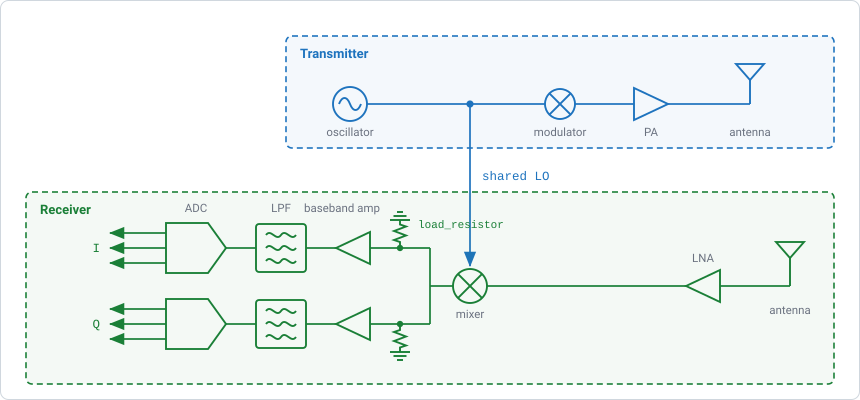
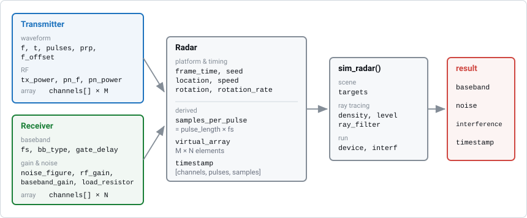
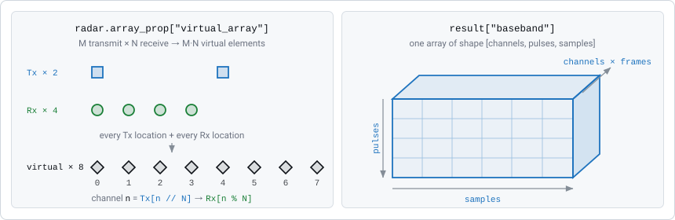

Radar System Model
==================

Every RadarSimPy simulation uses three objects:

* a :class:`radarsimpy.Transmitter`, which describes the transmitted signal,
* a :class:`radarsimpy.Receiver`, which describes how the echo is received and
  sampled,
* a :class:`radarsimpy.Radar`, which combines the two and places them in the
  scene.

This page explains what each object contains, what ``Radar`` calculates from
them, and how this sets the shape of the simulation output.

The Transceiver
---------------

RadarSimPy models a coherent radar: the receiver mixes the echo with the same
oscillator signal that the transmitter sends. This mixing step is called
*deramping* or *dechirping*.

    The transmit chain generates, modulates, amplifies and radiates the
    waveform. The receive chain amplifies the echo and mixes it with a copy of
    the same signal, so the baseband output contains the *difference* between
    the transmitted and received signals. The mixer has an I and a Q output.
    ``bb_type="complex"`` returns both; a real baseband keeps only one.

Because the transmitter and receiver share one oscillator, the baseband signal
is coherent with the transmitted waveform. This is why, in an FMCW radar, a
target's range shows up as a beat frequency. It is also why phase noise
partly cancels for nearby targets (see :doc:`noise`).

Two things follow from this design:

* **There is no separate IF stage to configure.** The mixer output is the
  simulated baseband. :class:`radarsimpy.Receiver` describes everything from
  the antenna to the analog-to-digital converter (ADC).
* **The mixer reference is a delayed copy of the transmitted waveform.** The
  delay is zero by default. The receiver's ``gate_delay`` changes it, which is
  how long-range stretch processing works (:doc:`stretch_processing`).

From Objects to Baseband
------------------------

    ``Transmitter`` and ``Receiver`` only hold settings. ``Radar`` places them
    on a platform and calculates the timing and the array geometry.
    ``sim_radar`` adds the scene and produces the output arrays.

A minimal complete simulation:

.. code-block:: python

   from radarsimpy import Radar, Transmitter, Receiver
   from radarsimpy.simulator import sim_radar

   wavelength = 3e8 / 79e9

   tx = Transmitter(
       f=[77e9, 81e9],      # 4 GHz sweep
       t=[0, 40e-6],        # 40 us chirp
       tx_power=15,
       pulses=128,
       prp=50e-6,
       channels=[{"location": (0, 0, 0)}],
   )

   rx = Receiver(
       fs=20e6,
       noise_figure=8,
       rf_gain=20,
       baseband_gain=30,
       load_resistor=500,
       channels=[
           {"location": (0, i * wavelength / 2, 0)} for i in range(4)
       ],
   )

   radar = Radar(transmitter=tx, receiver=rx)

   result = sim_radar(radar, targets=[{"location": (50, 0, 0), "rcs": 10}])
   baseband = result["baseband"] + result["noise"]

Each object is responsible for one part of the setup:

.. list-table::
   :header-rows: 1
   :widths: 22 78

   * - Object
     - Responsible for
   * - ``Transmitter``
     - The waveform (frequency over time), the number of pulses and their
       spacing, transmit power, phase noise, and the transmit antennas. See
       :doc:`transmitter`.
   * - ``Receiver``
     - Sampling rate, baseband type, gains and noise from antenna to ADC, the
       range gate, and the receive antennas. See :doc:`receiver`.
   * - ``Radar``
     - The platform's position and motion, frame start times, and the random
       seed. All other ``Radar`` properties are *calculated* from the
       transmitter and receiver.
   * - ``sim_radar``
     - The scene: targets, ray-tracing settings, interference, and whether to
       run on CPU or GPU. See :doc:`ray_tracing_simulation`.

What the Radar Calculates
-------------------------

When you create a ``Radar``, it calculates four things from the transmitter and
receiver together.

Samples per pulse
~~~~~~~~~~~~~~~~~

The receiver records for one pulse length per pulse, so

.. math::

   \text{samples\_per\_pulse} = \text{pulse\_length} \times f_s

The result must be at least 1, or the constructor raises an error. Read it back
with ``radar.samples_per_pulse``.

.. note::

   Choose ``fs`` and ``pulse_length`` so that their product is an exact
   integer. If floating-point rounding puts the product just below an integer
   (for example ``fs = N / 20e-6`` with ``N`` a power of two), RadarSimPy
   rounds it to the nearest integer, but a clean product avoids the issue.

The virtual array
~~~~~~~~~~~~~~~~~

With :math:`M` transmit channels and :math:`N` receive channels, the simulator
outputs :math:`M \times N` *virtual channels*, one for each transmit–receive
pair. Each virtual channel acts like a single antenna placed at the sum of its
transmit and receive locations:

    Left: two transmit antennas spaced by the width of the receive array give
    eight evenly spaced virtual channels from six physical antennas. Right:
    the output arrays are indexed ``[channel, pulse, sample]``.

The channel order is fixed, with the receive index changing fastest:

.. code-block:: text

   ch[0]       = Tx0 -> Rx0
   ch[1]       = Tx0 -> Rx1
   ...
   ch[N-1]     = Tx0 -> Rx(N-1)
   ch[N]       = Tx1 -> Rx0
   ...
   ch[M*N-1]   = Tx(M-1) -> Rx(N-1)

So channel ``n`` uses ``Tx[n // N]`` and ``Rx[n % N]``. The virtual channel
positions are in ``radar.virtual_array_locations``, an ``[M*N, 3]`` array.

.. note::

   The simulator returns the :math:`M \times N` channels already separated,
   even if all transmitters are on at the same time. Real hardware has to
   separate them with a modulation scheme such as TDM, CDM or DDM. See
   `Simultaneous Transmit Channels`_ below.

The timestamp
~~~~~~~~~~~~~

``radar.time_prop["timestamp"]`` holds the time of every sample. It has the
same ``[channels, pulses, samples]`` shape as the baseband and is the sum of
four parts:

.. code-block:: text

   timestamp[ch, p, s] = frame_start_time            # Radar(frame_time=...)
                       + delay[ch // N]              # Tx channel delay
                       + pulse_start_time[p]         # cumsum(prp) - prp[0]
                       + gate_delay + s / fs         # receive window

The simulator also uses these timestamps to move targets and the radar. Moving
objects are written as functions of ``radar.time_prop["timestamp"]``.
Anything that changes the timestamps — a transmit delay, a range gate, uneven
pulse spacing — also changes when the motion is sampled.

Noise amplitude
~~~~~~~~~~~~~~~

The standard deviation of the thermal noise depends only on the receiver's
gains and bandwidth. It is calculated once, when the ``Radar`` is created, and
stored in ``radar.sample_prop["noise"]``. :doc:`receiver` shows the
calculation.

Frames
------

``frame_time`` repeats the whole pulse sequence at a list of start times. The
frames are stacked along the first (channel) axis, with the frame index
changing slowest:

.. code-block:: python

   radar = Radar(transmitter=tx, receiver=rx, frame_time=[0, 0.1, 0.2])

   result = sim_radar(radar, targets)
   # result["baseband"].shape == (3 * M * N, pulses, samples)

   cube = result["baseband"].reshape(3, M * N, pulses, samples)

Each frame has its own independent thermal noise. Within a frame, virtual
channels that share a physical receiver and a timestamp have *identical*
noise. :doc:`noise` explains what this means for covariance estimation.

Simultaneous Transmit Channels
------------------------------

``sim_radar`` computes every transmit–receive path **separately**. Channel
``n`` contains only the signal that ``Tx[n // N]`` sent and ``Rx[n % N]``
received. It does not include signals from the other transmitters, even if
they were transmitting at the same time. Adding a second transmitter does not
change the first transmitter's channels:

.. code-block:: python

   two = sim_radar(radar_2tx, targets)["baseband"]   # 2 Tx × 1 Rx → 2 channels
   one = sim_radar(radar_1tx, targets)["baseband"]   # the same scene, Tx0 only

   np.allclose(two[0], one[0])   # True — bit for bit

Real hardware is different. A physical receiver picks up the sum of all
transmitters that are on while it is recording, and a MIMO modulation scheme
is needed to separate them again. The simulator gives you the result of a
perfect separation. If you need the summed signal, you build it yourself.

Why the outputs are kept separate
~~~~~~~~~~~~~~~~~~~~~~~~~~~~~~~~~

RadarSimPy has no "MIMO mode" setting. TDM, CDM, DDM and intra-pulse coding
are all built from the same basic transmitter settings — a per-channel
``delay``, a ``pulse_phs`` sequence, a ``mod_t`` / ``phs`` table, and
``f_offset`` (see :doc:`transmitter`). The simulator cannot tell which scheme
you intend, so it does not mix the channels for you. Summing separate channels
is easy, but separating a sum is generally impossible, so returning separate
paths keeps every option open.

The same applies to the other outputs. ``baseband`` contains only the target
echoes, with no noise. ``noise`` and ``interference`` are returned as separate
arrays of the same shape. Add together only the parts you need.

.. note::

   Because the fast-time modulation table repeats identically in every pulse,
   one call can simulate one OFDM symbol or one phase code. A frame that
   carries *different* data in each symbol (a full OFDM data frame or an OTFS
   grid) needs several calls, which you then combine yourself.

Building the physical receive signal
~~~~~~~~~~~~~~~~~~~~~~~~~~~~~~~~~~~~

To get what each physical receiver would record, sum the transmit channels
that share a receiver. The first axis is ordered frame, then Tx, then Rx, so a
reshape does this:

.. code-block:: python

   import numpy as np

   M = radar.transmitter.num_channels
   N = radar.receiver.num_channels
   P = radar.transmitter.num_pulses
   S = radar.samples_per_pulse
   K = np.size(radar.time_prop["frame_start_time"])

   result = sim_radar(radar, targets)

   signal = result["baseband"].reshape(K, M, N, P, S).sum(axis=1)
   noise = result["noise"].reshape(K, M, N, P, S)[:, 0]

   physical = signal + noise      # [frames, Rx, pulses, samples]

.. important::

   Sum the signal, but add the noise only **once**. Virtual channels that share
   a physical receiver and a timestamp contain the *same* noise values. If you
   sum ``result["noise"]`` over the transmitters, the noise amplitude grows by
   a factor of :math:`M`, because you are adding :math:`M` copies of the same
   noise. A real receiver has one noise source, which is what ``[:, 0]`` keeps.

When this matters
~~~~~~~~~~~~~~~~~

* **TDM** — each transmitter has its own time slot (a per-channel ``delay``),
  so the signals never overlap. The separate outputs already match the
  hardware. No extra work is needed.
* **CDM and DDM** — all transmitters are on at the same time and are separated
  afterwards, by code or by Doppler. Sum the channels to study what the
  demodulator really sees: cross-talk between codes, interaction between a
  target's Doppler and the DDM phase ramp, and the ADC dynamic range needed
  for :math:`M` overlapping echoes.
* **No modulation** — transmitters at different locations sending the same
  waveform at the same time cannot be separated at all. The simulator still
  returns :math:`M \times N` channels, but real hardware would return only
  :math:`N`. A virtual array built from the simulator output in this case
  could not exist in hardware.

.. note::

   Using the :math:`M \times N` channels directly is fine for many studies,
   such as array geometry, angle estimation and beam patterns. It is faster
   and simpler than simulating a modulation scheme only to undo it. Just make
   this choice on purpose.

See Also
--------

* :doc:`transmitter` — waveform, pulse train and transmit array
* :doc:`receiver` — sampling, gain, noise budget and receive array
* :doc:`coordinate_systems` — how ``location`` and ``rotation`` are interpreted
* :doc:`noise` — thermal noise and phase noise
* :doc:`ray_tracing_simulation` — the scene side of ``sim_radar``
* :doc:`../api/radar` — full API reference for the three classes
