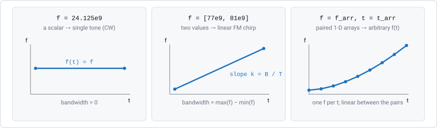
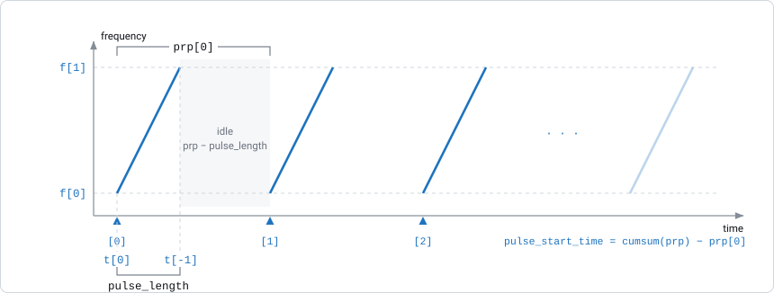
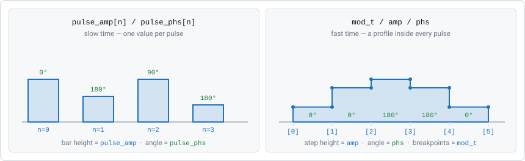
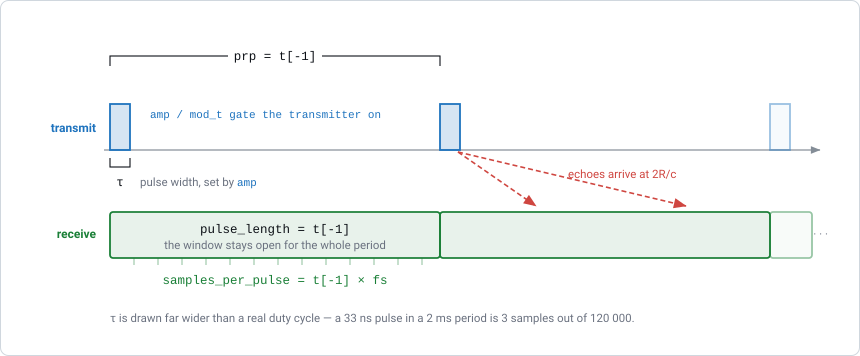
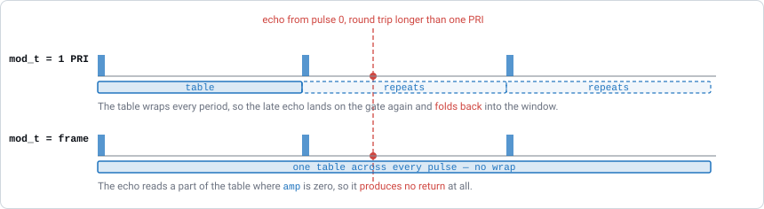

Transmitter and Waveform
========================

:class:`radarsimpy.Transmitter` describes the signal the radar sends. It
covers four things:

1. the **waveform** — how the frequency changes over one pulse,
2. the **pulse train** — how many pulses there are and how far apart they are,
3. the **modulation** — amplitude and phase changes applied to each pulse and
   each channel,
4. the **transmit channels** — antenna positions and patterns.

This page goes through them in that order. For how the transmitter fits into a
complete simulation, see :doc:`system_model`.

The Waveform: ``f`` and ``t``
-----------------------------

The waveform is defined by two arrays of the same length: ``f`` holds
frequencies and ``t`` holds the times at which the waveform has those
frequencies. Between two points, the frequency changes linearly.

    Each value in ``f`` pairs with the value at the same index in ``t``. The
    frequency changes linearly between consecutive points.

There are three ways to use them:

.. list-table::
   :header-rows: 1
   :widths: 30 70

   * - Form
     - Result
   * - ``f=24.125e9, t=1e-6``
     - Single-tone continuous wave (CW). A single ``f`` value becomes
       ``[f, f]`` and a single ``t`` value becomes ``[0, t]``, so the
       frequency is constant and ``bandwidth`` is 0.
   * - ``f=[77e9, 81e9], t=[0, 40e-6]``
     - Linear chirp — the FMCW case. The chirp slope is
       ``(f[1] - f[0]) / pulse_length``, available as ``radar.chirp_slope``.
   * - ``f=f_arr, t=t_arr``
     - Any frequency sweep. Use as many points as you need. Because the
       frequency is linear between points, approximate a curved sweep by
       using enough points.

Two values are calculated from these arrays and used throughout the
simulator:

.. code-block:: text

   bandwidth    = max(f) - min(f)
   pulse_length = t[-1] - t[0]

``t`` is shifted so that it starts at zero; only the differences between its
values matter. ``pulse_length`` is especially important:

* together with the receiver's sampling rate ``fs``, it sets the number of
  samples per pulse,
* it is the minimum allowed time between pulse starts.

.. note::

   For a descending sweep, put the higher frequency first:
   ``f=[81e9, 77e9]`` gives a negative ``chirp_slope``. ``bandwidth`` is
   always positive, because it is ``max(f) - min(f)``.

.. code-block:: python

   from radarsimpy import Transmitter

   cw    = Transmitter(f=24.125e9, t=1e-6)
   fmcw  = Transmitter(f=[77e9, 81e9], t=[0, 40e-6])

   # a non-linear (quadratic) sweep, 64 breakpoints
   import numpy as np
   t_arr = np.linspace(0, 40e-6, 64)
   f_arr = 77e9 + 4e9 * (t_arr / 40e-6) ** 2
   nlfm  = Transmitter(f=f_arr, t=t_arr)

The Pulse Train: ``pulses`` and ``prp``
---------------------------------------

``f`` and ``t`` describe *one* pulse. ``pulses`` sets how many pulses are sent,
and ``prp`` (pulse repetition period) sets the time between the **starts** of
consecutive pulses:

    ``prp`` is measured from the start of one pulse to the start of the next.
    If ``prp`` is longer than ``pulse_length``, the transmitter is idle in
    between. If they are equal, the chirps follow each other with no gap,
    which is typical for fast-chirp FMCW.

Rules:

* ``prp`` must be at least ``pulse_length`` for every pulse; a pulse cannot
  start before the previous one ends.
* ``prp`` can be a single value (used for all pulses) or an array with one
  value per pulse.
* If you omit ``prp``, it defaults to ``pulse_length`` (100 % duty cycle).

The start time of each pulse, relative to the first pulse, is:

.. code-block:: text

   pulse_start_time = cumsum(prp) - prp[0]

A single ``prp`` value gives evenly spaced pulses. An array gives *staggered*
pulses, which pulsed radars commonly use to resolve Doppler ambiguity:

.. code-block:: python

   import numpy as np
   from radarsimpy import Transmitter

   # alternating 50 us / 60 us PRP over 128 pulses
   prp = np.tile([50e-6, 60e-6], 64)
   tx = Transmitter(f=[77e9, 81e9], t=[0, 40e-6], pulses=128, prp=prp)

.. important::

   The receiver records for one ``pulse_length``, starting ``gate_delay``
   after each pulse starts. It does **not** record during the idle time
   between pulses. For a pulsed radar that listens after it transmits, use the
   receiver's ``gate_delay`` to move the recording window to the ranges you
   want — see :doc:`stretch_processing`.

Frequency Hopping: ``f_offset``
-------------------------------

``f_offset`` adds a fixed frequency shift to each pulse. It applies to all
transmit channels, and its length must equal ``pulses``. A single value is
applied to every pulse.

.. code-block:: python

   import numpy as np
   from radarsimpy import Transmitter

   # 64 pulses, hopping in 10 MHz steps
   tx = Transmitter(
       f=[24.0e9, 24.1e9],
       t=[0, 20e-6],
       pulses=64,
       prp=25e-6,
       f_offset=np.arange(64) * 10e6,
   )

Frequency hopping increases the total bandwidth covered over a frame. This
helps with interference mitigation and synthetic-bandwidth range processing.
The downside is that the pulses are no longer identical, which affects
coherent Doppler processing and long range gates.

Modulation: Slow Time and Fast Time
-----------------------------------

Each transmit channel has two independent kinds of modulation. Make sure you
use the right one:

    Left: **pulse modulation** — one amplitude and one phase per pulse,
    constant during the pulse. Right: **waveform modulation** — a profile
    applied *within* each pulse, the same for every pulse.

.. list-table::
   :header-rows: 1
   :widths: 18 41 41

   * -
     - Pulse modulation
     - Waveform modulation
   * - Keys
     - ``pulse_amp``, ``pulse_phs``
     - ``mod_t``, ``amp``, ``phs``
   * - Changes over
     - Slow time (from pulse to pulse)
     - Fast time (within a pulse)
   * - Length
     - Must equal ``pulses``
     - Any length; ``amp``, ``phs`` and ``mod_t`` must have the same length
   * - Typical use
     - Phase codes, Doppler-division MIMO, amplitude tapering across a frame
     - Pulse shaping, phase codes within a pulse, per-channel frequency offsets

Both are complex gains, ``amp * exp(1j * phs * pi / 180)`` (phase in degrees),
and both default to 1 (no modulation).

Pulse modulation
~~~~~~~~~~~~~~~~

``pulse_amp`` and ``pulse_phs`` are set per channel and have one value per
pulse. A typical use is giving each MIMO transmit channel its own code so the
channels can be separated:

.. code-block:: python

   import numpy as np
   from radarsimpy import Transmitter

   pulses = 128

   # Doppler-division MIMO: each Tx gets its own phase ramp across the frame,
   # which shifts its returns to a different Doppler bin.
   n = np.arange(pulses)
   channels = [
       {"location": (0, 0, 0),        "pulse_phs": np.zeros(pulses)},
       {"location": (0, 0.006, 0),    "pulse_phs": (180 * n) % 360},
   ]

   tx = Transmitter(
       f=[77e9, 81e9], t=[0, 40e-6], pulses=pulses, prp=50e-6, channels=channels
   )

Waveform modulation
~~~~~~~~~~~~~~~~~~~

``mod_t`` holds time points, and ``amp`` / ``phs`` hold the amplitude and phase
at those times. Between time points the value is held constant (zero-order
hold): the simulator uses the most recent point, without interpolation. The
same profile is applied to every pulse.

Together, these three arrays define any complex envelope. This lets you build
waveforms that are not frequency sweeps: a phase code, a shaped pulse, or an
OFDM symbol (load the subcarriers, take an inverse FFT, and use the result as
``amp`` and ``phs`` on the ``mod_t`` grid). Because the profile repeats in
every pulse, one call simulates one symbol. A frame with different data in each
symbol needs several calls — see :doc:`system_model`.

.. important::

   ``mod_t`` must be **evenly spaced and increasing**. The simulator calculates
   the time step from ``mod_t[1] - mod_t[0]`` and uses it for every lookup, so
   uneven time points are read incorrectly without any error. Use
   ``np.linspace(0, pulse_length, n)`` and choose ``n`` for the time resolution
   you need.

Example: a raised-cosine amplitude taper.

.. code-block:: python

   import numpy as np
   from radarsimpy import Transmitter

   pulse_length = 40e-6
   mod_t = np.linspace(0, pulse_length, 256)
   taper = 0.5 - 0.5 * np.cos(2 * np.pi * np.arange(256) / 255)

   tx = Transmitter(
       f=[77e9, 81e9],
       t=[0, pulse_length],
       pulses=128,
       prp=50e-6,
       channels=[{"location": (0, 0, 0), "mod_t": mod_t, "amp": taper}],
   )

You can set only one of ``amp`` and ``phs``. If you give only ``phs``,
``amp`` is filled with ones; if you give only ``amp``, ``phs`` is filled with
zeros.

Separating MIMO channels
~~~~~~~~~~~~~~~~~~~~~~~~

A virtual array only works if the receiver can tell the transmit channels
apart (see :doc:`system_model`). These are the options:

.. list-table::
   :header-rows: 1
   :widths: 20 34 46

   * - Scheme
     - Configured with
     - Notes
   * - TDM (time division)
     - Per-channel ``delay``
     - Each channel transmits at a different time within the PRP. Simple and
       fully separable, but the effective pulse rate per channel drops by a
       factor of :math:`M`.
   * - CDM (code division)
     - Per-channel ``pulse_phs``
     - Each channel uses a different (orthogonal) phase code over the frame,
       e.g. rows of a Hadamard matrix. All channels transmit at once, so the
       pulse rate is not reduced.
   * - DDM (Doppler division)
     - Per-channel ``pulse_phs`` ramp
     - A phase that increases from pulse to pulse shifts each channel into its
       own Doppler band. This reduces the unambiguous Doppler range instead of
       the pulse rate.
   * - Intra-pulse
     - Per-channel ``mod_t`` / ``amp`` / ``phs``
     - Phase codes, or a linear phase ramp (which is a frequency offset),
       applied within each pulse. The ``mod_t`` time step limits how fine the
       ramp can be.

Pulsed Waveforms
----------------

A pulsed radar transmits for a short time and then listens for a long time.
To model this, remember one rule:

.. important::

   ``t`` defines the **receive window**, not how long the transmitter is on.

For CW and FMCW the two are the same: the transmitter is on for the whole
sweep. For a pulsed radar they differ by orders of magnitude, so you set them
separately:

* ``t`` covers the whole pulse repetition interval. This sets
  ``pulse_length``, the samples per pulse and, by default, ``prp``.
* ``amp`` and ``mod_t`` switch the transmitter on for the first :math:`\tau`
  seconds of the interval (the pulse width) and off for the rest.

    Blue: the transmitter switched on by ``amp``. Green: the receive window,
    which is open for the whole period and is set by ``t``.

A rectangular pulse
~~~~~~~~~~~~~~~~~~~

.. code-block:: python

   import numpy as np
   from scipy import constants
   from radarsimpy import Radar, Transmitter, Receiver

   c = constants.c
   fc = 10e9            # carrier
   prf = 20e3           # pulse repetition frequency
   fs = 20e6            # ADC rate
   pulse_width = 0.5e-6 # tau

   prp = 1 / prf                          # 50 us listening window
   n = int(round(prp * fs))               # samples in that window

   mod_t = np.arange(n) / fs
   amp = np.zeros(n)
   amp[mod_t < pulse_width] = 1.0         # transmitter on for the first tau

   tx = Transmitter(
       f=fc,                              # single tone: an unmodulated pulse
       t=prp,                             # the whole interval, not the pulse
       tx_power=40,
       pulses=256,
       channels=[{"location": (0, 0, 0), "mod_t": mod_t, "amp": amp}],
   )

   rx = Receiver(fs=fs, noise_figure=5, rf_gain=20, baseband_gain=30,
                 channels=[{"location": (0, 0, 0)}])

   radar = Radar(transmitter=tx, receiver=rx)

``prp`` is not set here, so it defaults to ``pulse_length``, which is already
the full interval. Setting ``prp=1/prf`` gives the same result.

.. list-table::
   :header-rows: 1
   :widths: 42 22 36

   * - Quantity
     - Expression
     - This example
   * - Samples per pulse
     - ``prp * fs``
     - 1000
   * - Transmit-on samples
     - ``tau * fs``
     - 10
   * - Duty cycle
     - ``tau / prp``
     - 1 %
   * - Max unambiguous range
     - ``c * prp / 2``
     - 7.49 km
   * - Range resolution
     - ``c * tau / 2``
     - 75 m
   * - Range per sample
     - ``c / (2 * fs)``
     - 7.5 m

A target at range :math:`R` produces an echo starting near sample
:math:`2R f_s / c`, lasting the :math:`\tau f_s` samples of the pulse. For
example, a point target at 1500 m appears within one sample of index 200. That
index converts back to 1491 m, which is within one 7.5 m range bin.

How long ``mod_t`` should be
~~~~~~~~~~~~~~~~~~~~~~~~~~~~

The example above makes ``mod_t`` one interval long. You can also make it as
long as the whole frame: ``np.arange(int(prp * pulses * fs)) / fs``. The choice
controls what happens to a target beyond the maximum unambiguous range,
:math:`c \cdot \text{prp} / 2`:

    The modulation table is looked up by time within a pulse. A one-interval
    table therefore repeats every interval, and a frame-long table does not. A
    late echo reads a "transmitter on" value in the first case and a
    "transmitter off" value in the second.

.. list-table::
   :header-rows: 1
   :widths: 22 39 39

   * - ``mod_t`` covers
     - One interval
     - The whole frame
   * - Length
     - ``int(prp * fs)``
     - ``int(prp * pulses * fs)``
   * - Target beyond :math:`R_\text{max}`
     - Folds back to :math:`R - c\,\text{prp}/2`, as in real hardware
     - Returns exactly zero — not visible
   * - Use when
     - You want to study range ambiguity
     - You only want unambiguous returns (usually simpler)

With the 50 µs interval above (:math:`R_\text{max}` = 7.49 km), a target at
9 km folds back to about 1.5 km when ``mod_t`` covers one interval: its echo
starts near sample 201, where a real radar would also report it. With a
frame-long table, the same target does not appear at all.

A chirped pulse
~~~~~~~~~~~~~~~

With an unmodulated pulse, a shorter pulse gives better range resolution but
puts less energy on the target. *Pulse compression* avoids this trade-off by
sweeping the frequency during the pulse.

Because ``f`` and ``t`` can have any number of points, you can sweep during the
first :math:`\tau` seconds and hold the frequency constant for the rest of the
interval, where ``amp`` has already switched the transmitter off:

.. code-block:: python

   bandwidth = 10e6

   tx = Transmitter(
       f=[fc - bandwidth / 2, fc + bandwidth / 2, fc + bandwidth / 2],
       t=[0, pulse_width, prp],
       tx_power=40,
       pulses=256,
       channels=[{"location": (0, 0, 0), "mod_t": mod_t, "amp": amp}],
   )

The three points sweep across the pulse and then hold. ``bandwidth`` is
10 MHz, and ``pulse_length`` is still the full 50 µs interval, so the number of
samples per pulse does not change. After matched filtering, the range
resolution is :math:`c / 2B` — 15 m here, compared with 75 m for the
rectangular pulse of the same length.

.. note::

   The simulator returns the received echo, not the compressed range profile.
   Apply matched filtering yourself to ``result["baseband"]``: correlate each
   pulse with the transmitted waveform, then continue with Doppler processing
   as usual.

Practical notes
~~~~~~~~~~~~~~~

* **Eclipsing.** If a target is so close that its echo arrives while the
  transmitter is still on, the echo falls in the first :math:`\tau f_s`
  samples. Real hardware cannot receive during this time, but the simulator
  can. If you model a system with a real duplexer, discard those samples
  yourself.
* **Duty cycle.** Real duty cycles are small. The SAR example on
  `radarsimx.com <https://radarsimx.com/2026/06/30/pulse-radar-sar-imaging/>`_
  switches the transmitter on for 3 samples out of 120 000. A long window at a
  high ``fs`` means many samples per pulse, and memory use grows with it.
* **Range gating.** For long ranges, start the receive window at the ranges you
  care about instead of at zero delay, to avoid sampling empty space. See
  :doc:`stretch_processing`.
* **Staggered PRF.** ``prp`` accepts an array, so the interval can change from
  pulse to pulse. Because ``t`` also sets the window length and
  ``prp >= pulse_length`` is required, staggering can only make intervals
  longer than ``t[-1]``, never shorter. Set ``t`` to the *shortest* interval
  you need and make the others longer. The receive window always has the same
  length, so a longer interval just adds idle time after the window closes.

Transmit Channels
-----------------

``channels`` is a list of dictionaries, one per transmit antenna. Only
``location`` is required.

.. list-table::
   :header-rows: 1
   :widths: 24 16 60

   * - Key
     - Default
     - Meaning
   * - ``location``
     - —
     - ``[x, y, z]`` in metres, relative to the radar origin.
   * - ``polarization``
     - ``[0, 0, 1]``
     - Antenna polarization vector. Vertical ``[0, 0, 1]``, horizontal
       ``[0, 1, 0]``, right-hand circular ``[0, 1, 1j]``, left-hand circular
       ``[0, 1, -1j]``.
   * - ``delay``
     - ``0``
     - Transmit start delay in seconds. Use it for TDM. It shifts the
       channel's timestamps.
   * - ``azimuth_angle`` / ``azimuth_pattern``
     - ``[-90, 90]`` / ``[0, 0]``
     - Angles (degrees) and gains (dB) of the azimuth pattern. Same length.
   * - ``elevation_angle`` / ``elevation_pattern``
     - ``[-90, 90]`` / ``[0, 0]``
     - The same, for elevation.
   * - ``grid``
     - ``1``
     - Angular step in degrees used during ray tracing to find which
       directions contain objects. Only affects mesh simulations.
   * - ``pulse_amp`` / ``pulse_phs``
     - ``1`` / ``0``
     - Slow-time modulation, one value per pulse.
   * - ``mod_t`` / ``amp`` / ``phs``
     - ``None``
     - Fast-time modulation.

Antenna patterns and gain
~~~~~~~~~~~~~~~~~~~~~~~~~

Patterns are given in dB versus angle. The azimuth and elevation patterns are
treated differently:

* The **peak of the azimuth pattern** is used as the channel's antenna gain
  (``txchannel_prop["antenna_gains"]``). The azimuth pattern is then
  normalized to its peak.
* The **elevation pattern** is normalized to its own peak, so only its shape
  matters.

So put the absolute gain in ``azimuth_pattern``, and use ``elevation_pattern``
only for the shape. Example: a channel with 12 dBi peak gain and a 60° azimuth
beamwidth.

.. code-block:: python

   channel = {
       "location": (0, 0, 0),
       "azimuth_angle": [-90, -30, 0, 30, 90],
       "azimuth_pattern": [-10, 9, 12, 9, -10],   # peak 12 dB -> antenna gain
       "elevation_angle": [-90, -20, 0, 20, 90],
       "elevation_pattern": [-20, -3, 0, -3, -20],  # shape only
   }

Angles follow the conventions in :doc:`coordinate_systems`.

Power and Phase Noise
---------------------

``tx_power`` is the transmit power in dBm. It scales the received signal
directly.

``pn_f`` and ``pn_power`` describe the oscillator's phase noise as a
single-sideband profile: frequency offsets in Hz, and noise power in dBc/Hz at
those offsets. Set both or neither.

.. code-block:: python

   tx = Transmitter(
       f=[77e9, 81e9],
       t=[0, 40e-6],
       tx_power=15,
       pulses=128,
       prp=50e-6,
       pn_f=[1e3, 1e4, 1e5, 1e6],
       pn_power=[-80, -90, -100, -110],
   )

The receiver mixes the echo with the same oscillator signal, so phase noise
partly cancels for short delays (nearby targets) and less so for longer ones.
:doc:`noise` covers this in detail.

Reading the Configuration Back
------------------------------

.. code-block:: python

   tx.bandwidth           # max(f) - min(f), Hz
   tx.pulse_length        # t[-1] - t[0], s
   tx.num_pulses
   tx.num_channels
   tx.channel_locations   # [M, 3]
   tx.get_channel_info(0) # location, polarization, delay, gain, patterns

   tx.waveform_prop["pulse_start_time"]
   tx.txchannel_prop["antenna_gains"]

See Also
--------

* :doc:`system_model` — how the transmitter combines with the receiver
* :doc:`receiver` — the other half of the transceiver
* :doc:`noise` — the phase-noise model
* :doc:`coordinate_systems` — angle and orientation conventions
* :doc:`stretch_processing` — range gating for long-range FMCW
* :doc:`../api/radar` — full ``Transmitter`` API reference
